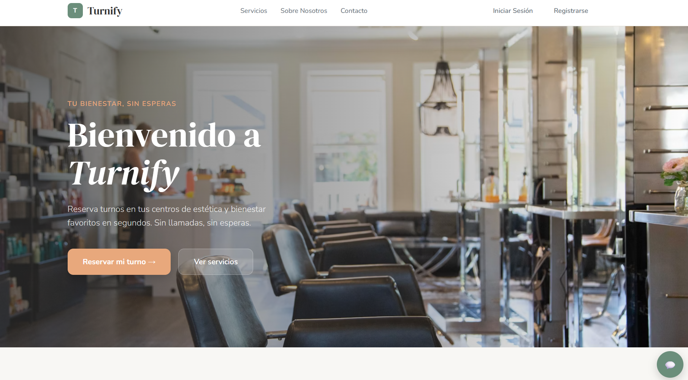
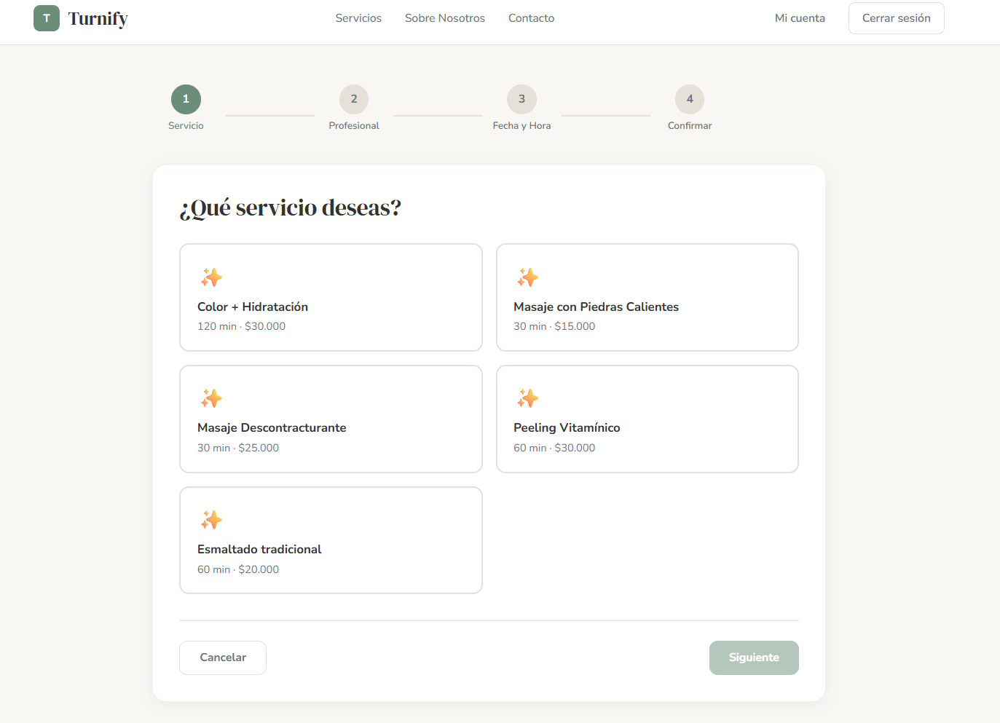
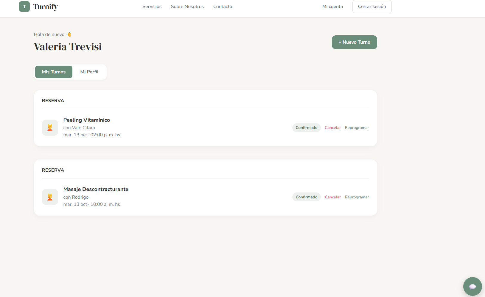
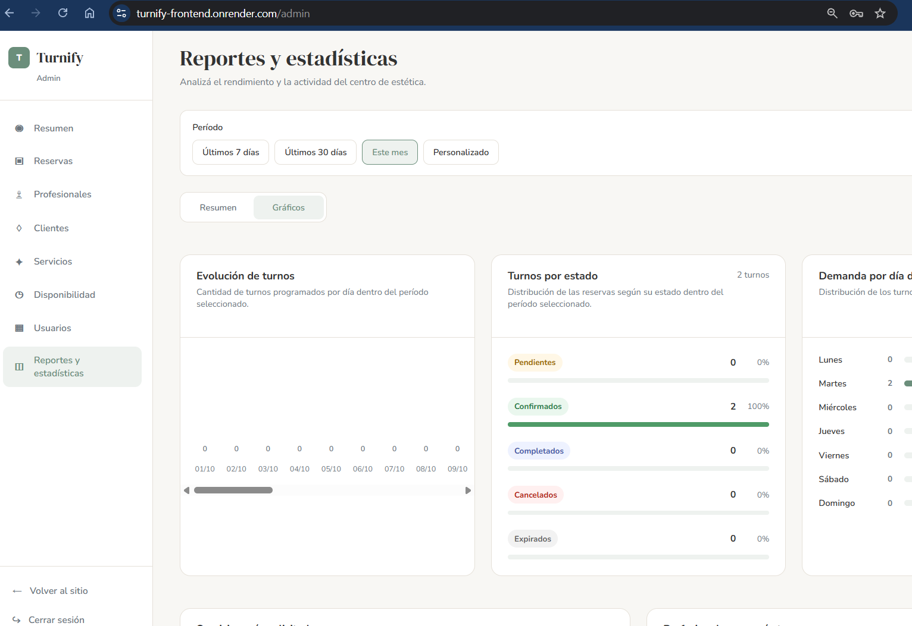
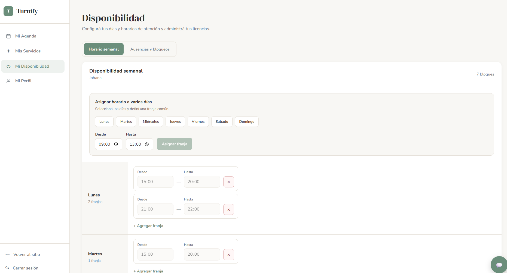

# Turnify

**Turnify** es una aplicación web Full Stack orientada a la gestión y reserva de turnos para centros de estética y bienestar. El sistema permite a clientes reservar turnos online, a profesionales administrar su disponibilidad y a administradores gestionar servicios, usuarios, reservas y estadísticas del negocio.

## Demo
- **Aplicación desplegada:** https://turnify-frontend.onrender.com/
- **Repositorio Backend:** https://github.com/Turnify-Proyect/Turnify
- **Repositorio Frontend:** https://github.com/Turnify-Proyect/Turnify-Frontend

## Tecnologías utilizadas

### Frontend
- React
- JavaScript
- Vite
- CSS

### Backend
- NestJS
- TypeScript
- TypeORM
- PostgreSQL
- JWT para autenticación y autorización

### Herramientas y despliegue
- Git y GitHub
- Docker
- Render
- Supabase

## Funcionalidades principales

### Cliente
- Registro e inicio de sesión.
- Visualización de servicios disponibles.
- Reserva de turnos mediante flujo guiado.
- Cancelación y reprogramación de turnos.
- Gestión de perfil y visualización de reservas.
- Confirmaciones y recordatorios.

### Profesional
- Gestión de agenda personal.
- Configuración de disponibilidad semanal.
- Gestión de ausencias y bloqueos.
- Visualización de servicios asignados.
- Consulta de turnos programados.

### Administrador
- Gestión de servicios, profesionales, usuarios y clientes.
- Administración de reservas.
- Configuración de disponibilidad.
- Visualización de reportes y estadísticas.
- Exportación de datos.

## Capturas del sistema

> Sugerencia: crear una carpeta `docs/screenshots/` dentro del repositorio donde vayas a publicar este README y guardar allí las imágenes con los nombres indicados debajo.

### 1. Página de inicio
Muestra la propuesta de valor de la plataforma y el acceso rápido al flujo de reserva de turnos.



### 2. Flujo de reserva de turnos
Proceso guiado para que el cliente seleccione servicio, profesional, fecha y horario antes de confirmar la reserva.



### 3. Panel del cliente
Vista donde el usuario puede consultar sus reservas, gestionar su perfil, cancelar turnos y reprogramarlos.



### 4. Panel administrativo y estadísticas
Sección destinada al administrador, con métricas, reportes y visualización del rendimiento del centro de estética.



### 5. Panel del profesional
Interfaz para que el profesional gestione su disponibilidad semanal, horarios de atención, ausencias y bloqueos.



## Arquitectura general
Turnify se encuentra dividido en dos repositorios principales:

- **Turnify**: backend desarrollado con NestJS y TypeScript.
- **Turnify-Frontend**: frontend desarrollado con React, JavaScript y Vite.

Esta separación permite trabajar de forma colaborativa sobre el cliente y el servidor, manteniendo responsabilidades diferenciadas y un flujo de desarrollo más ordenado.

## Instalación local

> **Importante:** completar esta sección con las variables de entorno y credenciales necesarias antes de publicarlo como documentación definitiva.

### Backend
```bash
git clone https://github.com/Turnify-Proyect/Turnify.git
cd Turnify/backend
npm install
npm run start:dev
```

### Frontend
```bash
git clone https://github.com/Turnify-Proyect/Turnify-Frontend.git
cd Turnify-Frontend
npm install
npm run dev
```

## Participación en el proyecto
Turnify fue desarrollado de manera colaborativa como proyecto final del bootcamp de **Soy Henry**.

## Equipo de desarrollo
- [Valeria Trevisi](https://github.com/Valeriat92)
- [Leandro Bock](https://github.com/LeandroBock)
- [José Buenahora](https://github.com/josebuenahoras)
- [Lautaro Schroeder](https://github.com/LautaroSch-hub)
- [Max Camacho](https://github.com/MazzCamacho23)

## Posibles mejoras futuras
- Integración de pagos más completa.
- Mejora de métricas y visualizaciones del panel de administración.
- Mayor personalización de recordatorios y notificaciones.
- Optimización de experiencia de usuario en paneles y flujos de reserva.

## Estado del proyecto
Proyecto funcional con despliegue en línea, desarrollado como entrega final del bootcamp Full Stack.
